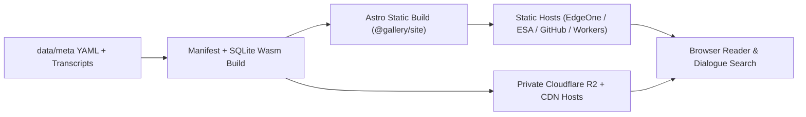

<p align="center">
  
</p>

<h1 align="center">Pagehaven · 页间</h1>

<p align="center">Good stories, between the pages.</p>

<p align="center">
  <a href="README.md"></a>
  <a href="README.en.md"></a>
</p>

<p align="center">
  <a href="https://pagehaven.cbnv.me/en/">Docs Site</a> · <a href="#quick-start">Quick Start</a> · <a href="#pre-adoption-faq">Pre-Adoption FAQ</a> · <a href="#reading-paths">Reading Paths</a> · <a href="#license--acknowledgements">License &amp; Acknowledgements</a>
</p>

Pagehaven is a **pure-static comic archive, multi-mode reader, and browser-side dialogue search engine** (AGPL-3.0) backed by external private object storage and edge CDNs; it intentionally omits user accounts, comments, SSR servers, and online admin uploads.

## Core Capabilities & Data Flow

- **One HTML per Chapter, Progressive Reading**: Compiled with Astro 7.4 into a single static page per chapter to fit 2k–20k file budgets; readable with zero JavaScript, and enhanced with single-page / long-strip / double-page layouts, RTL/LTR, `#p<n>b<i>` dialogue jump highlights, and opt-in `@yui540/comimi` pagination.
- **Browser-Side SQLite Wasm Search**: Indexes dialogue with a deterministic `normalizeText` pipeline (NFKC → punctuation/symbol strip → OpenCC `t->cn` → lowercase) into `FTS5 trigram` SQLite; runs `MATCH` for `>=3` chars and `LIKE` for `2` chars after SHA-256 verification within a `30 MiB` whole-download guard.
- **Local Library & Validated JSON Backup**: Reading progress, shelf statuses, and 200-char page notes stay in browser `localStorage`, portable via schema-checked `pagehaven-reading-backup` JSON files (5 MiB / 20,000 records cap).
- **Portable Multi-Target Immutable Releases**: A single `dist/` output targets EdgeOne, ESA, GitHub Pages, Workers, and legacy Cloudflare Pages, while WebP pages and SQLite artifacts are served from private Cloudflare R2 through CDN hosts with atomic pointer activation.

## Capabilities & Explicit Non-Goals

| Area | What Pagehaven Delivers | Explicit Non-Goals & Hard Bounds |
| --- | --- | --- |
| Archive & Reader | One static HTML per chapter readable without JS, single/long-strip/double/Comimi layouts, `#p<n>b<i>` deep links | **No** user accounts, comments, SSR server runtimes, or online media upload portals |
| Search & Chunking | Deterministic `normalizeText` + SQLite Wasm (`MATCH` >=3 / `LIKE` 2); standalone HTTP Range `chunkfetch` SDK | Rejects `<2`-char normalized queries; `30 MiB` whole-DB cap; `chunkfetch` **not yet wired** to browser VFS; raw OCR drafts excluded |
| Shelves & Backups | Browser-local progress, bookmarks, 200-char notes, and schema-checked `pagehaven-reading-backup` JSON migration | Enforces `5 MiB` / `20,000`-record backup ceiling; **no** cloud account sync |
| Static Delivery | Portable single build; private R2 upload + randomized live HTTPS proofs + ETag `If-Match` `manifest.json` flip | ESA hard cap `2,000` files (`<=1,999` app files); rejects `preview` on `github`/`all`; refuses embedded secrets or placeholder domains |



## Quick Start

Requires **Node.js `>=22.19.0`** and **pnpm `>=10.0.0`** (the template repository starts with an empty catalog):

```sh
pnpm install --frozen-lockfile
pnpm run build
pnpm run check
pnpm --filter @gallery/site run preview
```

This builds the static site and launches Astro preview on `http://localhost:4321` (set `DATA_DIR=packages/core/test/fixtures/data` to preview built-in sample data). Other entry workflows:

| Workflow | Command / Entry | Docs Reference |
| --- | --- | --- |
| Initialize & customize appearance | `pnpm run init` / `pnpm run customize` (`127.0.0.1:4318`) | [Getting Started](docs-site/en/docs/index.md) |
| Ingest LabelPlus / OCR transcripts | `pnpm run ingest:labelplus` / `pnpm run ingest:ocr` | [Configuration & Data Contracts](docs-site/en/docs/configuration.md) |
| Multi-target static deploy & R2 release | `publish:r2` → `release:prepare` → `deploy:*` → `release:activate` | [Deployment Matrix](docs-site/en/docs/deployment.md) |
| Run or build standalone VitePress docs | `pnpm --dir docs-site install --frozen-lockfile && pnpm --dir docs-site run docs:dev` | [Code Map & Docs Workflow](docs-site/en/docs/code-map.md) |
| Interactive Schema, SDK & Release CLI Reference | Browse `site.config.yaml`, `@gallery/*` contracts, and runnable samples | [API & Component Reference](docs-site/en/api-reference/index.md) |

## Pre-Adoption FAQ

**Can Pagehaven run fully without backend or edge functions?**
Yes. Even with `features.platform_config: false`, static chapter browsing, reader settings, shelves/backups, and browser-side SQLite Wasm search work completely client-side; `search.api_path` is only a reserved slot.

**Why keep Cloudflare R2 strictly private behind external CDN hosts?**
R2 credentials reside solely in CI secrets for immutable publishing. Readers fetch WebP images and SQLite search databases exclusively through `images.hosts` CDN domains via SigV4 private origin access.

**Why compile all pages of a chapter into one HTML file?**
Static host free tiers strictly cap file counts (Workers guard `18,000`, ESA hard cap `2,000` including proof reserve). One HTML per chapter keeps page count bounded while loading `/index/<series>.json` TOC chunks on demand.

**What happens if file budgets or SQLite download size limits are exceeded?**
`pnpm run check` and release preflight reject oversized outputs before upload (ESA `<=1,999` app files / `1,024,000,000 B`; `db.whole_download_max_bytes` defaults to `30 MiB`). Standalone HTTP Range probing exists in `@gallery/core/chunkfetch` and is not yet wired into SQLite VFS.

**Do OCR drafts automatically enter production search?**
No. `ingest:ocr` generates draft JSON and review HTML only; manually reviewed files must be explicitly promoted into `data/text/` with `--accept-reviewed` before participating in search DB or site builds.

**What automated checks guard builds and commits?**
`pnpm run check` verifies schema sync, target file/byte budgets, Web-standard boundaries, zero-`sharp` packaging, README fragment links, and CI pipeline policies, backed by `tools/githooks/`; see [CONTRIBUTING.md](CONTRIBUTING.md) for the full matrix.

## Reading Paths

| Goal | Docs Site (Usage & Operations) | Repo Engineering Docs (Code & Maintenance) |
| --- | --- | --- |
| Install, deploy across targets & troubleshoot | [Start](docs-site/en/docs/index.md) · [Deploy](docs-site/en/docs/deployment.md) · [FAQ](docs-site/en/docs/faq.md) | [Repo Docs Hub](repo-docs/README.md) · [Release Pipeline](repo-docs/modules/release-pipeline-and-proofs.md) |
| Config schema, data schemas & boundaries | [Boundaries](docs-site/en/docs/boundaries.md) · [Config](docs-site/en/docs/configuration.md) · [Interactions](docs-site/en/docs/interactions.md) | [Config & Targets](repo-docs/modules/site-config-and-targets.md) · [Data & Normalization](repo-docs/modules/data-model-and-normalization.md) |
| Real run walkthrough, search engine & reader | [Walkthrough](docs-site/en/docs/walkthrough.md) · [Architecture](docs-site/en/docs/architecture.md) · [Code Map](docs-site/en/docs/code-map.md) | [One Real Run](repo-docs/walkthroughs/one-real-run.md) · [Code Map](repo-docs/code-map.md) · [Architecture Spec](docs/ARCHITECTURE.md) |
| Search, chunkfetch, reader & domain glossary | [Architecture Subsystems](docs-site/en/docs/architecture.md) | [Search & Chunkfetch](repo-docs/modules/search-db-and-chunkfetch.md) · [Reader & Bookmarks](repo-docs/modules/static-reader-and-bookmarks.md) · [Glossary](repo-docs/glossary.md) |
| Historical ADRs, design tokens & contributing | [Changelog & Migrations](docs-site/en/docs/changelog.md) · [DESIGN.md](DESIGN.md) | [Change Log](repo-docs/change-log.md) · [CONTRIBUTING.md](CONTRIBUTING.md) · [SECURITY.md](SECURITY.md) |

## License & Acknowledgements

Licensed under [AGPL-3.0-only](LICENSE). Workspace overrides explicitly drop optional `astro>sharp` (LGPL libvips) via Astro's noop image service, and bundled fonts/licenses live in `packages/site/public/licenses/`.

Built with [Astro](https://astro.build/), [SQLite Wasm](https://sqlite.org/wasm), [opencc-js](https://github.com/nk2028/opencc-js), [@yui540/comimi](https://github.com/yui540/comimi), [Anime.js](https://animejs.com/), and [VitePress](https://vitepress.dev/).

- **Additional Terms & Assets**: Pursuant to Section 7 of GNU AGPLv3, Covered Material is governed by [`LICENSE-ADDITIONAL_TERMS-zh-CN.md`](LICENSE-ADDITIONAL_TERMS-zh-CN.md) (English reference translation: [`LICENSE-ADDITIONAL_TERMS-en.md`](LICENSE-ADDITIONAL_TERMS-en.md); the Simplified Chinese Full Text prevails), setting forth provenance, modification marking, anti-impersonation, conditional permissive-extension exemptions, and project identifier boundaries; engineering guidance is provided in [`IMPLEMENTATION-GUIDE.zh-en.md`](IMPLEMENTATION-GUIDE.zh-en.md), and the unified four-section manifest of human authors, AI assistants, upstream/third-party code, and independent artwork, fonts, and project identifiers is maintained in [`ASSETS_LICENSES.md`](ASSETS_LICENSES.md). Authorization for additional requirements and for Sections 9.5–9.6 additional permissions is verified separately per copyright holder; third-party or upstream materials remain governed by their existing valid licenses.
