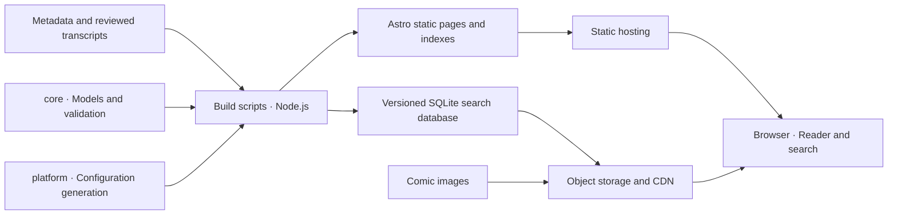

<p align="center">
  <a href="README.md"></a>
  <a href="README.en.md"></a>
</p>

<p align="center">
  
</p>

<h1 align="center">Pagehaven · 页间</h1>

<p align="center">Good stories, between the pages.</p>

<p align="center">
  <a href="#features">Features</a> · <a href="#getting-started">Getting started</a> · <a href="#deployment">Deployment</a> · <a href="#section-1">Architecture</a> · <a href="#limitations">Current limits</a>
</p>

**Pagehaven is a general-purpose static comic site.** It brings a comic catalog, reader, and dialogue search together in a warm paper-white, ink-blue, and teal theme, for building your own comic library.

Built with Astro, the site can be deployed to Cloudflare Pages, EdgeOne Makers, or GitHub Pages. Images and search databases live in object storage and are read through a CDN; browsing and search do not require an always-running application server. The repository includes no actual comics, hosted accounts, or preconfigured deployment projects.

Chinese is the default README; use the buttons above to switch languages. The website currently has a Chinese interface. The README language switch changes documentation only.

<a id="features"></a>

## Features

- **Catalog browsing:** Series / issue / chapter / page navigation, covers, authors, tags, each series' latest chapter, a random chapter, and metadata search. Latest chapters follow issue / chapter order, not publication dates.
- **Comic reading:** Single-page, long-strip, and double-page modes; reading direction, keyboard and swipe navigation, fullscreen, brightness, and page jumps. Reading progress is saved automatically and can be resumed from the home and series pages.
- **Long series and unreliable connections:** The full chapter list loads when first opened, with filtering and current-chapter navigation. Images try backup sources automatically and offer per-page retry after failure, while transcript overlays remain readable.
- **Dialogue links:** Selectable, copyable text overlays and search results that link directly to a page and text box. The search page shows actual transcript coverage.
- **Browser-side search:** Download and verify the matching release's SQLite database, filter by series, and paginate results. The database loads only after the first valid query.
- **Content import:** Import LabelPlus transcripts. When no transcript is available, generate an OCR draft, review it, and explicitly accept it before indexing.
- **Optional enhanced pagination:** Enable the reader option with `features.comimi_reader` for zoom and gesture support. It is disabled by default and can fall back to the standard reader if loading fails.
- **Static releases:** One HTML file per chapter, with indexes, sitemaps, and platform configuration generated at build time. The release pipeline checks immutable resources, deployment receipts, and version consistency.

<a id="section-2"></a>
<a id="section-3"></a>
<a id="getting-started"></a>

## Getting started

Requires **Node.js 22.19.0+ and npm 9.6.5+** to meet the locked dependencies' minimum versions. Run the following commands in a Codespaces terminal. Python 3 is used by collaboration guards; optional OCR also requires Tesseract and the relevant language packs.

```bash
npm ci
npm run init -- --ui-lang en # Interactive setup; confirm to save, or build with the defaults
npm run build     # Generate configuration, database, pages, indexes, and sitemap; no deployment
npm run check     # Check configuration sync, data, artifact budgets, and lint
npm test          # Test data models, readers, search, builds, and release workflows
```

The first complete build generates the intermediate files. An empty content directory also builds successfully, with an explicit empty state on the home page.

Preview the build:

```bash
npm run preview --workspace @gallery/site -- --host 0.0.0.0
```

In the Codespaces **Ports** panel, open the preview port printed in the terminal. For page development, run `npm run dev --workspace @gallery/site -- --host 0.0.0.0`. Rebuild after changing `site.config.yaml` or `data/` to refresh generated data. The development server does not serve metadata indexes generated in `dist/index/`; use the built `preview` for complete search verification.

The complete build runs:

```text
build:config → build:manifest → build:db → build:site → build:index → build:sitemap
```

To explore sample chapters, build the test fixtures in a Codespaces Bash terminal:

```bash
DATA_DIR=packages/core/test/fixtures/data DIST_DIR=out/demo-dist OUT_DIR=out/demo-build npm run build
python3 -m http.server 4173 --bind 0.0.0.0 --directory out/demo-dist
```

Fixtures contain fictional metadata and dialogue, without comic images. This preview server requires Python 3; supply your own images to preview real artwork. The sample build refreshes shared generated data, so run `npm run build` again before returning to the default site.

## Configuration and content

[`site.config.yaml`](site.config.yaml) is the single configuration source. `npm run init` interactively sets the site name, domains, image sources, and feature flags, using the current configuration as defaults. Cancelling leaves the file unchanged. The tool defaults to Chinese; use `npm run init -- --ui-lang en` for English.

You can also preview changes with command-line arguments:

```bash
npm run init -- --ui-lang en --title "My Comic Library" --domain gallery.example.org --image-host images.example.org --target cloudflare --project my-comics
npm run init -- --ui-lang en --help
```

Argument mode previews changes by default. Append `--write` to the same command to save them after review. `--dry-run` explicitly requests a preview and cannot be combined with `--write`. Use argument mode in non-interactive environments. Repeat `--image-host` for up to two sources; `--text-layer`, `--enhanced-reader`, and `--platform-config` accept `true` or `false`. `--site-lang` sets the HTML language tag without translating the website interface.

`--target` accepts `none` (the default), `cloudflare`, `edgeone`, or `github` and selects platform setup guidance only. The actual release target is still chosen in the manual release form. `--project` writes the Cloudflare project name; other platform account identifiers and credentials remain in secrets. Initialization accepts example domains for previews and does not create cloud resources or deploy the site.

The tool preserves existing comments and unselected fields and validates the complete configuration. Before saving, it backs up the original in `out/init/` (overridable with `OUT_DIR`), replaces the file atomically through a temporary file in the same directory, and stops if it detects a concurrent configuration edit. Use `--config` to edit another existing configuration; otherwise, `CONFIG_FILE` takes precedence over the repository root file. Run `npm run build` afterwards to refresh generated configuration and site artifacts.

Review these fields before first use:

| Setting | Purpose |
|---|---|
| `site.title` | Default site name: “页间 · Pagehaven” |
| `site.domain` | Production site domain |
| `site.lang` | HTML language tag, `zh-CN` by default; changing it does not translate interface text |
| `images.hosts` | CDN domains for images and search resources |
| `deploy` | Project settings for the selected hosting platform |
| `features` | Feature flags, including text overlays and enhanced pagination |

The example domains are for build previews only. Production site deployments reject example site or image domains; upload-only runs with `target=none` do not run this deployment check. Platform files are generated; do not manually edit `_headers`, `_redirects`, or `edgeone.json`.

1. Add series, issues, chapters, and pages to `data/meta/`, following the [metadata format](data/meta/README.md).
2. Prepare images and a CDN, ensuring that image keys and dimensions in the metadata match the actual files.
3. Put LabelPlus transcripts in `data/raw/labelplus/` and run `npm run ingest:labelplus`. For OCR drafting, review, and acceptance, see the [source transcript guide](data/raw/README.md).
4. Rebuild, run checks and tests, then publish through the manual release workflow.

Comics without transcripts remain readable but do not appear in dialogue search. See [`data/text/README.md`](data/text/README.md) for the text-layer format.

Before importing, run `npm run ingest:labelplus -- --dry-run` to preview chapters that would be created,
updated, or left unchanged, together with all warnings and errors. The preview creates no directories
and writes no files. `CHAPTERS` and `LABELPLUS_PAGES` still control selection and page mapping; use
`--help` for usage. Without `--dry-run`, valid chapters are imported even if other chapters fail; those
writes are retained and the command exits with a nonzero status. Multiple `.txt` / `.TXT` drafts for
one chapter are reported as a conflict and that chapter is skipped. Metadata and accepted transcripts
must use lowercase `.yaml` / `.yml` / `.json` extensions.

<a id="deployment"></a>

## Deployment

The deployment adapters support **Cloudflare Pages, EdgeOne Makers, and GitHub Pages**. `npm run build` only generates files. Production releases are started manually with the release button on the CNB branch page. Pushing `main` runs checks only; there are no automatic or scheduled deployments.

The release sequence is: **validate → prepare baseline → upload immutable resources → deploy → activate production version → record status and submit search updates**. Preview and upload-only runs leave the production pointer unchanged. Search pages use the database from the same build.

The CNB release form requires `publish_secrets_url`. Selecting a deployment target also requires `deploy_secrets_url`. These must point to publishing and deployment secret files that you are authorized to reference. Upload-only runs still require publishing secrets. Default checks do not read external secret files.

Secret-file addresses use HTTPS and the `/-/blob/<ref>/<file>.yml` form; YAML and JSON files are also supported. Do not embed credentials, query parameters, or fragments in these addresses. CNB checks file existence and access permissions. Keep account identifiers and credentials out of the repository.

See the [architecture](docs/ARCHITECTURE.md), [collaboration and pipeline guide](CONTRIBUTING.md), and [release form](.cnb/web_trigger.yml) for platform differences and release parameters. The latest recorded release status is in [`STATUS.md`](STATUS.md).

<a id="section-1"></a>

## Architecture



Platform-independent code uses Web-standard APIs. Filesystem access and publishing stay in build scripts. GitHub Pages is the static baseline: core reading and browser-side search should remain available with platform-specific configuration disabled.

<a id="section-4"></a>

### Repository layout

| Path | Responsibility |
|---|---|
| [`packages/site/`](packages/site/README.md) | Astro pages, reader, open-book icon, and shared theme |
| [`packages/core/`](packages/core/README.md) | Models, parsing, normalization, database construction, and Range-fetch components |
| [`packages/search/`](packages/search/README.md) | Database loading, verification, dialogue queries, and search-page wiring |
| [`packages/platform/`](packages/platform/README.md) | Site configuration schema and platform configuration generators |
| [`scripts/`](scripts/) | Import, build, validation, upload, and release orchestration |
| [`data/`](data/meta/README.md) | Comic metadata, source transcripts, and text layers |
| [`.cnb.yml`](.cnb.yml) | Automated checks and manual release pipelines |
| [`tools/`](tools/) | Collaboration guards and Git hooks |
| `dist/`, `out/` | Generated artifacts, excluded from version control |

Internal packages keep the `@gallery/*` names, and reading records keep the `gallery:*` storage keys. The project rename does not change these interfaces or existing records.

<a id="limitations"></a>

## Current limits

- Dialogue search currently downloads the whole database, with a default limit of **30 MiB**. Range-fetch components exist, but the SQLite Range VFS and function-based search are not connected yet.
- Queries need at least two characters after normalization. Two-character queries use `LIKE`; longer queries use FTS5 trigram. Only imported transcripts are searchable.
- OCR generates drafts for review and does not publish them automatically as final transcripts.
- There are no user accounts, comments, or web-based upload administration. The website does not yet have a Chinese/English interface switch.
- Current deployment entry points target the three static hosts above. A Cloudflare Workers application deployment workflow is not provided yet.

<a id="section-5"></a>

## Contributing

Work directly on `main`; there is no routine PR workflow. Keep one feature per commit, use a Conventional Commits prefix with a Chinese description, and follow the authorship, signing, and documentation rules. Keep feature descriptions, commands, and limits synchronized between both README languages.

Before committing, run `npm run check`, `npm test`, and `npm run build`. Read [`CONTRIBUTING.md`](CONTRIBUTING.md) for the full rules. Automated collaborators must also read [`CLAUDE.md`](CLAUDE.md) and [`AGENTS.md`](AGENTS.md). These maintenance documents are currently authoritative in Chinese.

<a id="section-6"></a>

## License

The project uses [GPL-3.0](LICENSE). Third-party components retain their own licenses. The optional pagination component's license is included in [`packages/site/public/licenses/comimi.txt`](packages/site/public/licenses/comimi.txt); collaboration-guard provenance is documented in [`tools/NOTICE.md`](tools/NOTICE.md).
