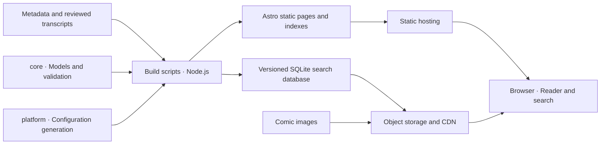

<p align="center">
  <a href="README.md"></a>
  <a href="README.en.md"></a>
</p>

<p align="center">
  
</p>

<h1 align="center">Pagehaven · 页间</h1>

<p align="center">Good stories, between the pages.</p>

<p align="center">
  <a href="#features">Features</a> · <a href="#getting-started">Getting started</a> · <a href="#deployment">Deployment</a> · <a href="#architecture">Architecture</a> · <a href="#current-limits">Current limits</a>
</p>

**Pagehaven is a general-purpose static comic site.** It brings a comic catalog, reader, and dialogue search together, with three light and dark palettes built around paper, ink, and teal, for building your own comic library.

Built with Astro, the site can be deployed to Cloudflare Pages, EdgeOne Makers, or GitHub Pages. Images and search databases live in object storage and are read through a CDN; browsing and search do not require an always-running application server. The repository includes no actual comics, hosted accounts, or preconfigured deployment projects.

Chinese is the default README; use the buttons above to switch languages. The website currently has a Chinese interface. The README language switch changes documentation only.

## Features

- **Catalog browsing:** Series / issue / chapter / page navigation, covers, authors, tags, each series' latest chapter, a random chapter, and metadata search. Latest chapters follow issue / chapter order, not publication dates.
- **Comic reading:** Single-page, long-strip, and double-page modes; reading direction, keyboard and swipe navigation, fullscreen, brightness, and page jumps. Reading progress is saved automatically and can be resumed from the home and series pages.
- **Personal library and recent reading:** Save series, manually mark them as Want to read / Reading / Read, filter by status and title, and sort by library updates or recent reading. A separate recent-chapter list lets you resume series without saving them to the library.
- **Page bookmarks:** The standard and enhanced readers share page favorites, with short notes. View bookmarks by series in your library, edit or remove them, and jump directly to the saved page.
- **Reading backups:** Export or restore saved series, progress, page bookmarks, and notes from your library. Preview before importing, merge while keeping existing records by default, and process everything in the browser.
- **Light and dark appearance:** Choose Light, Dark, or Follow system across all three palettes. The current browser remembers your choice, while comic images keep their original colors.
- **Long series and unreliable connections:** The full chapter index loads when first opened, showing up to 100 chapters per page with ascending/descending order, previous/next navigation, direct group-number jumps, text and progress filters, and current-chapter location across pages. Links return to saved reading positions. Images try backup sources automatically and offer per-page retry after failure, while transcript overlays remain readable.
- **Dialogue links:** Selectable, copyable text overlays and search results that link directly to a page and text box. The search page shows actual transcript coverage.
- **Browser-side search:** Download and verify the matching release's SQLite database, filter by series, and paginate results. The database loads only after the first valid query.
- **Content import:** Import LabelPlus transcripts. When no transcript is available, generate an OCR draft, review it, and explicitly accept it before indexing.
- **Optional enhanced pagination:** Enable the reader option with `features.comimi_reader` for zoom and gesture support, using your site's name, icon, and page-bookmark labels. It is disabled by default and can fall back to the standard reader if loading fails.
- **Site customization:** Maintainers can preview and edit the site name, logo, footer text, colors, heading font, navigation entries, and reading features in a browser, saving to the same site configuration.
- **Static releases:** One HTML file per chapter, with indexes, sitemaps, and platform configuration generated at build time. The release pipeline checks immutable resources, deployment receipts, and version consistency.

Open “目录” (Contents) in the reader, or press `t`, to see chapters with no saved position, a recorded page, or a last-page position. Combine title search with “有进度” (With progress) or “暂无进度” (No progress); chapter links with progress return to the recorded page. “定位当前章” (Locate current chapter) clears both filters and locates the current chapter. These are browsing positions and do not automatically mark a series as Read.

Open “我的书架” (My library) from the navigation or footer at `/library/`. Add a series from its page;
it starts as Want to read. Reading status is manual and does not automatically become Read when you
turn pages. Removing a series keeps its reading progress. Series without chapters can also be saved
and become readable once chapters are published.

“最近阅读” (Recent reading) shows the last saved position of each chapter, including series outside your library. Search by series, author, issue, or chapter; start with 20 records and expand for more. It reuses existing progress, keeps no separate visit log, and does not automatically change library membership or reading status.

While reading, bookmark the current page and add a note of up to 200 characters. Manage these in the
page-bookmark section of My library. A series does not need to be saved to your library first, and
removing it from the library keeps its page bookmarks. Existing enhanced-reader page favorites work
directly without migration. Notes require an explicit Save or Cancel; turning pages does not
automatically save an edit in progress.

The library, bookmarks, notes, and progress are stored in the current browser for the current site, with no account
sync. If browser storage is unavailable, the page explains that changes are kept temporarily on the current page only.
Save a backup before clearing site data or moving to another device or domain.

Library, bookmark, and progress updates arriving close together from other tabs refresh the view together. Returning to the window or refreshing records reads the latest data immediately; bookmark notes being edited keep their drafts.

### Switch between light and dark appearance

Use the appearance selector in the navigation to choose “浅色” (Light), “深色” (Dark), or “跟随系统” (Follow system). Follow system is the default and responds to system appearance changes. The choice is remembered for the current site and browser across page visits. If browser storage is unavailable, the page shows a notice and the choice still works on the current page.

The library, search, bookmarks, and reading controls share the selected appearance, including enhanced pagination. Comic images are not inverted. A small script reads a saved choice before the body is displayed to reduce a light flash on opening. Without JavaScript, CSS still follows the system and the manual selector remains hidden. This interface preference is excluded from reading-data backups and does not change site configuration or the publishing process.

### Back up and restore reading data

1. Open “备份与恢复” (Backup and restore) in My library and export a JSON backup. It includes saved library statuses, reading progress, page bookmarks, and notes, without comic images or the dialogue database.
2. Select that file in the library on another browser or domain. Review the counts of records to add, keep, replace, or repair. Previewing does not write data.
3. By default, keep existing statuses, progress, and notes, and combine bookmarked pages. To restore conflicting records from the file, explicitly choose the backup values, review the updated preview, and confirm the import. Records absent from the backup are not deleted.

Files are processed in the browser without uploads, accounts, or a backend. Migration matches series and chapter identifiers. Valid records for removed or not-yet-listed content are retained but remain hidden until the catalog matches; an orphaned note does not recreate a bookmark. Only successfully saved records are backed up. Save temporary changes and finish or cancel an open note edit before transferring data.

Backups are limited to **5 MiB and 20,000 records**, counting each bookmarked page separately. Invalid formats, versions, or contents are rejected; exporting skips damaged old records and reports their count. Changes after preview require another preview. Failed writes attempt to restore data written by that import and report incomplete recovery accurately. Keep the original backup, review the reported result, and retry when appropriate.

## Getting started

Requires **Node.js 22.19.0+ and npm 9.6.5+** to meet the locked dependencies' minimum versions. Run the following commands in a Codespaces terminal. Python 3 is used by collaboration guards; optional OCR also requires Tesseract and the relevant language packs.

```bash
npm ci
npm run init -- --ui-lang en # Interactive setup; confirm to save, or build with the defaults
npm run build     # Generate configuration, database, pages, indexes, and sitemap; no deployment
npm run check     # Check configuration sync, data, artifact budgets, and lint
npm test          # Test data models, readers, search, builds, and release workflows
```

The first complete build generates the intermediate files. An empty content directory also builds successfully, with an explicit empty state on the home page.

Preview the build:

```bash
npm run preview --workspace @gallery/site -- --host 0.0.0.0
```

In the Codespaces **Ports** panel, open the preview port printed in the terminal. For page development, run `npm run dev --workspace @gallery/site -- --host 0.0.0.0`. Rebuild after changing `site.config.yaml` or `data/` to refresh generated data. The development server does not serve metadata indexes generated in `dist/index/`; use the built `preview` for complete search verification.

The complete build runs:

```text
build:config → build:manifest → build:db → build:site → build:index → build:sitemap
```

To explore sample chapters, build the test fixtures in a Codespaces Bash terminal:

```bash
DATA_DIR=packages/core/test/fixtures/data DIST_DIR=out/demo-dist OUT_DIR=out/demo-build npm run build
python3 -m http.server 4173 --bind 0.0.0.0 --directory out/demo-dist
```

Fixtures contain fictional metadata and dialogue, without comic images. This preview server requires Python 3; supply your own images to preview real artwork. The sample build refreshes shared generated data, so run `npm run build` again before returning to the default site.

## Configuration and content

[`site.config.yaml`](site.config.yaml) is the single configuration source. `npm run init` interactively sets the site name, domains, image sources, and feature flags, using the current configuration as defaults. Cancelling leaves the file unchanged. The tool defaults to Chinese; use `npm run init -- --ui-lang en` for English.

You can also preview changes with command-line arguments:

```bash
npm run init -- --ui-lang en --title "My Comic Library" --domain gallery.example.org --image-host images.example.org --target cloudflare --project my-comics
npm run init -- --ui-lang en --help
```

Argument mode previews changes by default. Append `--write` to the same command to save them after review. `--dry-run` explicitly requests a preview and cannot be combined with `--write`. Use argument mode in non-interactive environments. Repeat `--image-host` for up to two sources; `--text-layer`, `--enhanced-reader`, and `--platform-config` accept `true` or `false`. `--site-lang` sets the HTML language tag without translating the website interface.

`--target` accepts `none` (the default), `cloudflare`, `edgeone`, or `github` and selects platform setup guidance only. The actual release target is still chosen in the manual release form. `--project` writes the Cloudflare project name; other platform account identifiers and credentials remain in secrets. Initialization accepts example domains for previews and does not create cloud resources or deploy the site.

The tool preserves existing comments and unselected fields and validates the complete configuration. Before saving, it backs up the original in `out/init/` (overridable with `OUT_DIR`), replaces the file atomically through a temporary file in the same directory, and stops if it detects a concurrent configuration edit. Use `--config` to edit another existing configuration; otherwise, `CONFIG_FILE` takes precedence over the repository root file. Run `npm run build` afterwards to refresh generated configuration and site artifacts.

### Site customization

```bash
npm run customize
```

Open the address printed in the terminal to edit the name, logo, and footer text; choose Paper, Ocean, or Plum colors, a custom accent, and serif or sans-serif headings; show or hide search and library navigation entries; and enable or disable text overlays and enhanced pagination. The preview updates as you edit. Only Save writes `site.config.yaml`. Preview light and dark appearances with the selector beside the preview; it does not change configuration or readers' preferences. Hiding navigation entries does not remove the corresponding pages, bookmarks, or reading records.

This is a temporary maintainer tool, bound to the loopback address by default and not deployed with the public site. If Codespaces requires listening on all interfaces, run `npm run customize -- --host 0.0.0.0`, open its port from the Ports panel, keep the port **private**, and append the printed `#token=…` fragment to the forwarded address. Do not make the forwarded port public or share a token-bearing address; stop the command when finished.

Use an HTTPS image URL or an on-site SVG path for the logo; `/favicon.svg` remains the default. Images can be hosted on your CDN. Current output budgets prohibit PNG, JPEG, WebP, and similar image files in `dist`, so the editor does not offer uploads. The logo is shared by navigation, the favicon, and the enhanced reader; third-party license notices remain intact.

Saving validates the settings, backs up the original in `out/customize/` (overridable with `OUT_DIR`), preserves comments and unselected fields, and refuses to overwrite concurrent edits. `--config` selects another existing configuration; otherwise, `CONFIG_FILE` takes precedence over the repository root file. A save only changes the source configuration. **Rebuild, check, and publish manually to apply it for all visitors**; the public static site needs no write endpoint.

Review these fields before first use:

| Setting | Purpose |
|---|---|
| `site.title` | Default site name: “页间 · Pagehaven” |
| `site.logo`, `site.tagline` | Logo URL and footer text; omitted values preserve the default icon and text |
| `appearance` | Theme, accent color, heading font, and search/library navigation entries; omitted values preserve the default appearance |
| `site.domain` | Production site domain |
| `site.lang` | HTML language tag, `zh-CN` by default; changing it does not translate interface text |
| `images.hosts` | CDN domains for images and search resources |
| `deploy` | Project settings for the selected hosting platform |
| `features` | Feature flags, including text overlays and enhanced pagination |

The example domains are for build previews only. Production site deployments reject example site or image domains; upload-only runs with `target=none` do not run this deployment check. Platform files are generated; do not manually edit `_headers`, `_redirects`, or `edgeone.json`.

1. Add series, issues, chapters, and pages to `data/meta/`, following the [metadata format](data/meta/README.md).
2. Prepare images and a CDN, ensuring that image keys and dimensions in the metadata match the actual files.
3. Put LabelPlus transcripts in `data/raw/labelplus/` and run `npm run ingest:labelplus`. For OCR drafting, review, and acceptance, see the [source transcript guide](data/raw/README.md).
4. Rebuild, run checks and tests, then publish through the manual release workflow.

Comics without transcripts remain readable but do not appear in dialogue search. See [`data/text/README.md`](data/text/README.md) for the text-layer format.

Before importing, run `npm run ingest:labelplus -- --dry-run` to preview chapters that would be created,
updated, or left unchanged, together with all warnings and errors. The preview creates no directories
and writes no files. `CHAPTERS` and `LABELPLUS_PAGES` still control selection and page mapping; use
`--help` for usage. Without `--dry-run`, valid chapters are imported even if other chapters fail; those
writes are retained and the command exits with a nonzero status. Multiple `.txt` / `.TXT` drafts for
one chapter are reported as a conflict and that chapter is skipped. Metadata and accepted transcripts
must use lowercase `.yaml` / `.yml` / `.json` extensions.

Check content after editing, without a full build:

```bash
npm run check:data
npm run --silent check:data -- --json
```

This reuses the build's format and cross-file validation, summarizes series, chapters, pages, and text
boxes, and lists chapters with no transcript or a transcript without searchable text. Missing or empty
transcripts are informational; the empty template is valid. A missing directory, a non-directory path,
invalid content, or invalid arguments produce a nonzero exit status. `DATA_DIR` can select another
existing data directory. The command is read-only, generates no artifacts, and does not read cloud
credentials or verify remote images. A full build and `npm run check` remain required before release.

The JSON report contains `ok`, `dataDir`, `totals`, `coverage`, `missingText`, `emptyText`, and `issues`.
`coverage.withText` counts chapters with a transcript; `searchableChapters`, `searchablePages`, and
`searchableBoxes` count chapters, pages, and boxes with nonempty search text. On failure, `totals` and
`coverage` are `null`. For machine-readable output, use `--silent` as shown above to suppress npm's
own script banner.

## Deployment

The deployment adapters support **Cloudflare Pages, EdgeOne Makers, and GitHub Pages**. `npm run build` only generates files. Production releases are started manually with the release button on the CNB branch page. Pushing `main` runs checks only; there are no automatic or scheduled deployments.

The release sequence is: **validate → prepare baseline → upload immutable resources → deploy → activate production version → record status and submit search updates**. Preview and upload-only runs leave the production pointer unchanged. Search pages use the database from the same build.

The CNB release form requires `publish_secrets_url`. Selecting a deployment target also requires `deploy_secrets_url`. These must point to publishing and deployment secret files that you are authorized to reference. Upload-only runs still require publishing secrets. Default checks do not read external secret files.

Secret-file addresses use HTTPS and the `/-/blob/<ref>/<file>.yml` form; YAML and JSON files are also supported. Do not embed credentials, query parameters, or fragments in these addresses. CNB checks file existence and access permissions. Keep account identifiers and credentials out of the repository.

See the [architecture](docs/ARCHITECTURE.md), [collaboration and pipeline guide](CONTRIBUTING.md), and [release form](.cnb/web_trigger.yml) for platform differences and release parameters. The latest recorded release status is in [`STATUS.md`](STATUS.md).

## Architecture



Platform-independent code uses Web-standard APIs. Filesystem access and publishing stay in build scripts. GitHub Pages is the static baseline: core reading and browser-side search should remain available with platform-specific configuration disabled.

### Repository layout

| Path | Responsibility |
|---|---|
| [`packages/site/`](packages/site/README.md) | Astro pages, reader, open-book icon, and shared theme |
| [`packages/core/`](packages/core/README.md) | Models, parsing, normalization, database construction, and Range-fetch components |
| [`packages/search/`](packages/search/README.md) | Database loading, verification, dialogue queries, and search-page wiring |
| [`packages/platform/`](packages/platform/README.md) | Site configuration schema and platform configuration generators |
| [`scripts/`](scripts/) | Import, build, validation, upload, and release orchestration |
| [`data/`](data/meta/README.md) | Comic metadata, source transcripts, and text layers |
| [`.cnb.yml`](.cnb.yml) | Automated checks and manual release pipelines |
| [`tools/`](tools/) | Collaboration guards and Git hooks |
| `dist/`, `out/` | Generated artifacts, excluded from version control |

Internal packages keep the `@gallery/*` names, and reading records keep the `gallery:*` storage keys. The project rename does not change these interfaces or existing records.

## Current limits

- Dialogue search currently downloads the whole database, with a default limit of **30 MiB**. Range-fetch components exist, but the SQLite Range VFS and function-based search are not connected yet.
- Queries need at least two characters after normalization. Two-character queries use `LIKE`; longer queries use FTS5 trigram. Only imported transcripts are searchable.
- OCR generates drafts for review and does not publish them automatically as final transcripts.
- There are no user accounts, comments, or web-based upload administration. The website does not yet have a Chinese/English interface switch.
- Current deployment entry points target the three static hosts above. A Cloudflare Workers application deployment workflow is not provided yet.

## Contributing

Work directly on `main`; there is no routine PR workflow. Keep one feature per commit, use a Conventional Commits prefix with a Chinese description, and follow the authorship, signing, and documentation rules. Keep feature descriptions, commands, and limits synchronized between both README languages.

When changing a section heading, update the navigation fragment to match the section link generated beside that heading on CNB. English headings use lowercase and hyphens (`Getting started` becomes `#getting-started`). `npm run check` checks section links in both READMEs.

Before committing, run `npm run check`, `npm test`, and `npm run build`. Read [`CONTRIBUTING.md`](CONTRIBUTING.md) for the full rules. Automated collaborators must also read [`CLAUDE.md`](CLAUDE.md) and [`AGENTS.md`](AGENTS.md). These maintenance documents are currently authoritative in Chinese.

## License

The project uses [GPL-3.0](LICENSE). Third-party components retain their own licenses. The optional pagination component's license is included in [`packages/site/public/licenses/comimi.txt`](packages/site/public/licenses/comimi.txt); collaboration-guard provenance is documented in [`tools/NOTICE.md`](tools/NOTICE.md).

The enhanced reader uses `site.title` and `site.logo`, which defaults to the site's favicon. Its reader information panel links to the third-party component's full MIT license. The interface branding changes preserve the original copyright and license notices, which ship with the static output.

## Documentation site

The [Chinese living guide](repo-docs/README.md) follows one real workflow and states what it leaves uncovered. Build or serve it with its separate Node.js dependencies:

```sh
npm --prefix docs-site ci
npm --prefix docs-site run docs:dev -- --host 127.0.0.1
npm --prefix docs-site run docs:build
```

The documentation site uses the default VitePress theme, with dependencies installed separately from the application. Output defaults to `docs-site/.vitepress/dist/`; append `-- --outDir <external-absolute-directory>` for an isolated build. Markdown remains in `repo-docs/` and is included by the site. Repository source links are shown as exact paths; source files and local resources are not published.
