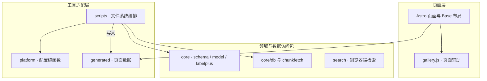

# comics-gallery · 漫画画廊

> **静态漫画阅读与元数据导航，配套可复用的数据模型和分块读取组件。**

已实现作品 / 期 / 话 / 页浏览、站点地图与浏览器端台词检索（sqlite-wasm 读库，整份下载 +
sha256 校验；按 Range 分块读取与函数版加速仍待做）。
产物是纯静态文件，托管在 Cloudflare Pages / EdgeOne Makers / GitHub Pages 三者之一，
随时切换；图片与检索库在对象存储，经 CDN 读取。设计与决策见
[`docs/ARCHITECTURE.md`](docs/ARCHITECTURE.md)。


**阅读导航**

[🏛️ 分层代码架构](#section-1) · [🚀 环境与使用入口](#section-2) · [🚀 怎么跑](#section-3) · [🏛️ 目录](#section-4) · [📚 参与开发](#section-5) · [📜 许可](#section-6)

---

<a id="section-1"></a>

## 🏛️ 分层代码架构

代码由 Astro 页面、可复用的纯逻辑包和 Node 工具组成。阅读页已有页面内交互；`packages/search` 已实现浏览器端台词检索（整份下载检索库 + sha256 校验 + FTS5 trigram 查询），按 Range 分块读取与函数版加速尚未接通。

图中展示主要代码依赖：实线箭头指向被调用或被依赖的模块，虚线表示实现或生成关系；数据读写另用连线文字标明。



| 层次 | 源码入口 | 职责与边界 |
|---|---|---|
| 页面层 | [Astro 页面与 Base 布局](packages/site/src/pages/) | 组织作品、分话、阅读与搜索页面。 |
| 页面层 | [gallery.js · 页面辅助](packages/site/src/lib/gallery.js) | 处理章节索引、图像地址和标注框样式。 |
| 领域与数据访问包 | [core · schema / model / labelplus](packages/core/src/index.js) | 验证和规范化作品、章节及台词模型；不依赖 Node IO。 |
| 领域与数据访问包 | [core/db 与 chunkfetch](packages/core/src/db/index.js) | 提供 SQLite 数据库构造与分块摘要；chunkfetch 提供 Range 获取、选源与缓存。 |
| 领域与数据访问包 | [search · 浏览器端检索](packages/search/src/index.js) | 按 manifest 下载并校验检索库，sqlite-wasm 查询台词，结果带 bbox 与阅读器 hash。 |
| 工具适配层 | [scripts · 文件系统编排](scripts/) | 读取本地输入并调用 core 和 platform；Node IO 留在此层。 |
| 工具适配层 | [platform · 配置纯函数](packages/platform/src/index.js) | 解析站点配置并生成各平台配置文本，不执行部署命令。 |
| 工具适配层 | [generated · 页面数据](packages/site/src/generated/) | 页面消费的元数据、配置和台词数据。 |

<a id="section-2"></a>

## 🚀 环境与使用入口

需要 Node.js 22+ 和 npm。可以在 Codespaces 中运行下方检查与构建；Python 3 用于可选 OCR 导入及协作守卫。构建与发布是不同步骤，`npm run build` 不部署网站。


<a id="怎么跑"></a>

<a id="section-3"></a>

## 🚀 怎么跑

```bash
npm ci
npm run check     # 预算守卫 + 配置生成物同步 + lint —— 提交前必过
npm test          # core 解析器 / 归一化 / DB 构建的单测
npm run build     # 全量静态构建（dry-run，不发布）
```

`npm run build` = `build:config → build:manifest → build:db → build:site → build:index → build:sitemap`。
发布（`verify:manifest`、`publish:r2`、`deploy:*`、`status`、`push:search`）只由 `.cnb.yml` 的
发布流水线手动触发；`ingest:labelplus` 把 `data/raw/labelplus/` 下的 LabelPlus 稿转成 `data/text/`。

<a id="目录"></a>

<a id="section-4"></a>

## 🏛️ 目录

```
.cnb.yml                流水线：main push 检查（+ last-green）、手动发布、归档分支（铁律 6）
.cnb/web_trigger.yml    main 分支详情页的按钮（发布 / 检查 / 归档）
site.config.yaml        唯一配置源：域名、缓存、响应头、重定向、功能开关（铁律 5）
data/meta/<series>.yaml 作品 / 期 / 话 / 页 元数据（人工维护）
data/text/<series>/…    台词层，每话一文件（ingest 生成）
data/raw/labelplus/     LabelPlus 原始稿（在 CNB 网页上传），ingest 的输入
packages/core           schema、LabelPlus 解析、归一化、DB 构建、取块层 —— 只用 Web 标准 API
packages/site           Astro：每话一个 HTML，阅读器，sitemap
packages/search         浏览器端检索：加载并校验检索库、台词查询、搜索页接线
packages/platform       三平台配置生成器与函数入口壳；生成物在 generated/
scripts/                构建期脚本（允许 Node），每个 = package.json 的一条 script
tools/                  守卫：agent-guard、分支体检、commit-msg / pre-push 钩子
.github/workflows       （已迁走；CNB 流水线见上面的 .cnb.yml）
dist/  out/             产物（不入库）
```

<a id="参与开发"></a>

<a id="section-5"></a>

## 📚 参与开发

直接提 `main`，没有 PR 流程；一功能一 commit，Conventional 前缀 + 中文；提交前
`npm run check && npm test` 全过。规则见 [`CONTRIBUTING.md`](CONTRIBUTING.md)，
AI 协作者的硬约束见 [`CLAUDE.md`](CLAUDE.md) 与 [`AGENTS.md`](AGENTS.md)。
钩子会在 Claude / Codex 跑过第一条命令后自动生效；人类手敲的克隆跑一次
`bash tools/install-hooks.sh`。

<a id="许可"></a>

<a id="section-6"></a>

## 📜 许可

GPL-3.0（见 [LICENSE](LICENSE)）。`tools/` 下守卫脚本的来源见 [`tools/NOTICE.md`](tools/NOTICE.md)。
