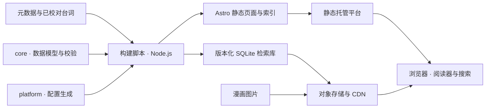

<p align="center">
  <a href="README.md"></a>
  <a href="README.en.md"></a>
</p>

<p align="center">
  
</p>

<h1 align="center">页间 · Pagehaven</h1>

<p align="center">在页间，遇见好故事。</p>

<p align="center">
  <a href="#主要功能">主要功能</a> · <a href="#怎么跑">开始使用</a> · <a href="#部署">部署</a> · <a href="#架构">架构</a> · <a href="#当前边界">当前边界</a>
</p>

**页间是一个通用的静态漫画站。** 它把作品目录、漫画阅读器和台词检索放在一起，以纸色、墨色与青绿为基础，提供三套深浅配色，适合建立自己的漫画资料库。

站点由 Astro 构建，提供 EdgeOne Makers、ESA Pages、GitHub Pages 和 Cloudflare Workers Static Assets 部署入口，并保留 Cloudflare Pages。图片与检索库保存在对象存储中，经 CDN 读取；浏览与检索不需要常驻应用服务器。仓库默认不附带实际漫画、线上账号或已配置的部署项目。各平台容量与预览边界见下方部署说明，适配代码不代表已经完成云端验收。

中文是默认 README；顶部按钮可切换到英文。网站当前默认中文界面，README 的语言切换只切换文档。


## 主要功能

- **作品浏览**：作品 / 期 / 话 / 页层级、封面、作者、标签、各作品最新一话、随机一话，以及元数据检索。“最新一话”按期 / 话顺序选取，不代表按发布时间排序。
- **漫画阅读**：单页、长条和双页模式，阅读方向、键盘与滑动翻页、全屏、亮度和页码跳转；自动保存阅读进度，首页和作品页可继续阅读。
- **个人书架与最近阅读**：收藏作品，手动标记“想读／在读／已读”，按状态和作品名筛选，按书架更新时间或最近阅读排列；独立查看最近阅读的章节，未收藏作品也可继续阅读。
- **阅读数据概览**：汇总收藏作品、有进度的作品与章节、页码书签及带文字备注书签，复用当前页面数据；存储受限和本页未保存修改会单独提示。
- **页码书签**：普通和增强阅读器共用页收藏，可添加简短备注；在书架按作品筛选，按备注、作品或章节等信息查找、修改或移除书签，直接跳到对应页。
- **阅读备份**：在书架导出或恢复收藏、进度、页码书签和备注；导入先预览，默认合并并保留已有记录，全程在浏览器内完成。
- **深浅配色**：在浅色、深色与跟随系统之间切换，三套主题均有深色版本；记住当前浏览器的选择，漫画图片保持原色。
- **长连载与弱网**：完整目录在首次打开时加载，每页最多显示 100 话，支持正序／倒序、前后翻页、输入组号跳转、文字与进度筛选，以及跨页定位当前章；显示各章阅读位置并可返回已记录页码。图片自动尝试备用来源，失败后可单独重试本页，台词层仍可读。
- **台词定位**：可选择和复制的文字层，搜索结果直达页码与台词框；页面显示实际台词稿覆盖率。
- **浏览器端搜索**：下载并校验对应版本的 SQLite 检索库，支持作品筛选与结果分页；首次有效查询才加载数据库。
- **内容导入**：支持 LabelPlus 台词稿；没有稿时，可生成 OCR 草稿，人工校对并明确接受后再纳入检索。
- **可选增强分页**：通过 `features.comimi_reader` 开启增强阅读入口，支持缩放和手势，界面使用本站名称、图标与页码书签文案；默认关闭，加载失败可回退到标准阅读器。
- **站点自定义**：维护者可在浏览器中预览和设置站名、Logo、页脚文案、配色、标题字体、导航入口及阅读功能，保存到同一份站点配置。
- **静态发布**：每话一个 HTML，构建时生成索引、sitemap 和平台配置；发布流水线校验不可变资源、部署回执和版本一致性。

在阅读页打开“目录”（或按 `t`），可查看各章“暂无进度”“读至第 N / M 页”或“已到末页”。章节名称筛选可与“有进度／暂无进度”组合使用；点击有进度的章节会返回已记录页码。“定位当前章”会清空筛选并定位当前阅读位置。这些提示只描述浏览位置，不会自动把作品标成“已读”。

从导航或页脚打开“我的书架”（`/library/`）。在作品页加入书架，默认标记为“想读”；
阅读状态由自己调整，不会随翻页自动变为“已读”。移出书架保留阅读进度；尚无章节的作品
也能收藏，发布章节后即可开始阅读。

“最近阅读”显示每话最后一次保存的位置，无需先收藏作品；可按作品、作者、期名或章节名查找，每次显示 20 条并可继续展开。它复用已有进度，不保存每次访问的流水，也不会自动修改作品收藏或阅读状态。

“阅读数据概览”按当前目录和页面恢复规则汇总可显示记录，不随搜索、筛选或分页改变。独立备注和编辑中的草稿不计入；备份另有校验并保留合法旧记录，条数可能不同。

阅读时可收藏当前页、编辑最多 200 字符的备注，在“我的书架”的页码书签区集中查看。
作品无需先加入书架即可保存页书签；移出作品书架也会保留页书签。增强阅读器已有的页收藏
直接兼容，不需要迁移。备注须明确保存或取消，翻页不会自动保存正在编辑的内容。

“查找书签”支持备注、作品名、作者、期名或章节名，与作品筛选组合使用。每次显示 50 条，可继续展开；更换关键词或作品时回到前 50 条。搜索复用已加载数据，不额外读取存储，编辑中的备注草稿不参与匹配，阅读数据概览的总数不变。

书架、书签、备注与进度保存在当前站点的当前浏览器中，没有账号同步。浏览器不允许保存时，
页面会提示修改仅在当前页面临时保留。清除站点数据或更换设备、域名前，可先保存备份文件。

保存或移除失败后，可使用“重试保存”完成剩余操作，或“放弃未保存修改”重新读取已保存记录。
正在编辑的备注须先保存或取消；所有未保存修改处理完后即可备份。
如果其他窗口已修改同一页，重试会提示冲突并保留待处理状态；可放弃未保存修改，核对最新记录后重新编辑。

多标签页同时使用时，短时间内连续到达的书架、书签和进度更新会合并刷新。回到窗口或手动刷新记录时，会立即读取最新数据；正在编辑的书签备注仍保留草稿。

### 切换深浅配色

在导航中的配色选项选择“浅色”“深色”或“跟随系统”，默认跟随系统。选择保存在当前站点的当前浏览器中，切换页面或再次打开时继续使用；跟随系统时，系统外观变化也会同步。浏览器不允许保存时会显示提示，本页仍可切换。

旁边的昼夜场景开关用于快速选择浅色或深色；需要恢复自动配色时，仍可从配色选项选择“跟随系统”。两种控件共用同一份状态，系统外观和其他标签页的修改会同步到场景开关。

书架、搜索、书签和阅读控件共用配色，增强分页也会同步；漫画图片不会反色。页面在显示正文前读取已保存的选择，减少首次打开时闪白。关闭 JavaScript 时仍通过 CSS 跟随系统，手动切换控件保持隐藏。该偏好属于界面设置，不包含在阅读数据备份中，也不改变站点配置或发布流程。

### 备份与恢复阅读数据

1. 打开“我的书架”的“备份与恢复”，导出一份 JSON 备份文件。它包含已保存的书架状态、阅读进度、页码书签和备注，不包含漫画图片或台词库。
2. 在另一浏览器或新域名的书架中选择该文件，查看将新增、保留、覆盖或修复的记录数量。此时尚未写入。
3. 默认保留本机已有的状态、进度和备注，页码书签取并集。需要恢复备份中的冲突记录时，明确选择使用备份，再核对预览并确认导入；备份以外的记录不会删除。

文件不上传服务器，无需账号或后台。迁移按作品与章节标识匹配；当前目录中已移除或尚未收录的合法记录仍会保留，但暂不显示，孤立备注不会重新创建书签。备份只包含已成功保存的记录；本页存在未保存的临时修改或正在编辑的备注时，先完成保存或取消编辑。

支持的备份上限为 **5 MiB、20,000 条记录**，每个收藏页单独计数。格式、版本或内容不合法时拒绝导入；导出跳过损坏的旧记录并提示数量。预览后检测到数据变化时需重新预览。写入失败会尝试恢复本次已写数据，并如实提示恢复不完整的情况；请保留原备份，按提示核对后再重试。

## 怎么跑

需要 **Node.js 22.19.0+ 和 pnpm 10+**，以满足锁定依赖的最低版本。以下命令可在 Codespaces 终端运行；Python 3 用于协作守卫，可选 OCR 另需 Tesseract 和对应语言包。

```bash
pnpm install --frozen-lockfile
pnpm --dir docs-site install --frozen-lockfile  # 完整测试需要独立的文档依赖
pnpm run init      # 中文交互配置站点，确认后写入；也可保留默认配置直接构建
pnpm run build     # 生成配置、检索库、静态页面、索引和 sitemap，不发布
pnpm run check     # 配置同步、数据校验、产物预算与 lint
pnpm test          # 数据模型、阅读器、搜索与构建发布测试
```

首次完整构建会生成所需的中间文件。空内容目录也能构建，首页会明确显示尚无作品。

预览构建结果：

```bash
pnpm run preview --workspace @gallery/site -- --host 0.0.0.0
```

在 Codespaces 的「端口」面板打开终端显示的预览端口。页面开发可运行 `pnpm run dev --workspace @gallery/site -- --host 0.0.0.0`；修改 `site.config.yaml` 或 `data/` 后，重新构建以刷新生成数据。开发服务器不提供构建到 `dist/index/` 的元数据索引，完整检索验收使用构建后的 `preview`。

完整构建顺序：

```text
build:config → build:manifest → build:db → build:site → build:index → build:sitemap
```

若只想查看示例章节，可在 Codespaces 的 Bash 终端使用测试夹具构建：

```bash
DATA_DIR=packages/core/test/fixtures/data DIST_DIR=out/demo-dist OUT_DIR=out/demo-build pnpm run build
python3 -m http.server 4173 --bind 0.0.0.0 --directory out/demo-dist
```

夹具仅包含虚构元数据与台词，没有漫画图片。上述预览服务器需要 Python 3；实际图像需自行配置。示例构建会刷新共用生成数据，返回默认站点前重新运行 `pnpm run build`。

## 配置与内容

[`site.config.yaml`](site.config.yaml) 是唯一配置源。`pnpm run init` 可交互设置站名、域名、图片源和功能开关，按当前配置提供默认值；取消时不写入。使用 `pnpm run init -- --ui-lang en` 可切换初始化工具的界面语言。

也可以通过参数预览修改：

```bash
pnpm run init -- --title "我的漫画站" --domain gallery.example.org --image-host images.example.org --target cloudflare --project my-comics
pnpm run init -- --help
```

参数模式默认只预览，确认后在同一条命令末尾加 `--write` 才写入；`--dry-run` 可显式预览，不能与 `--write` 同用。非交互环境应使用参数模式。图片源可重复传入 `--image-host`，最多两个；`--text-layer`、`--enhanced-reader` 和 `--platform-config` 接受 `true` 或 `false`。`--site-lang` 只设置 HTML 语言标记，不翻译网站界面。

`--target` 取 `none`（默认）、`edgeone`、`esa`、`github`、`workers` 或 `cloudflare`，仅选择平台设置提示；实际发布目标仍由手动发布表单指定。`--project` 写入 Cloudflare Pages 项目名，其他平台的账号标识和凭据仍放在 secrets。初始化允许示例域名用于预览，不创建云资源或触发部署。

工具保留已有注释和未选择的字段，复用完整配置校验；写入前将原文件备份到 `out/init/`（可由 `OUT_DIR` 覆盖），通过同目录临时文件原子替换，并在检测到配置被同时修改时中止。`--config` 可指定其他现有配置，未指定时依次使用 `CONFIG_FILE` 环境变量或仓库根文件。初始化后运行 `pnpm run build` 刷新派生配置和站点产物。

### 站点自定义

```bash
pnpm run customize
```

打开终端显示的地址，即可调整名称、Logo、页脚文案；选择纸白、海蓝或暮紫主题，设置自定义主色和衬线／无衬线标题；显示或隐藏搜索、书架入口，以及开关文字层和增强分页。预览随编辑更新，点击保存才写入 `site.config.yaml`。右侧可分别预览深浅配色，预览切换不会写入配置或更改读者的个人偏好。隐藏导航入口不会删除对应页面、已有书签或阅读记录。

这是维护期间临时启动的编辑器，默认只绑定回环地址，不随正式站点部署。Codespaces 如需外部监听，可运行 `pnpm run customize -- --host 0.0.0.0`，通过「端口」面板打开对应端口，保持可见性为**私有**，并在转发地址末尾保留终端显示的 `#token=…`。不要公开转发该端口或分享带令牌的地址，结束后停止命令即可。

Logo 可填写 HTTPS 图片地址或站内 SVG 路径，默认使用 `/favicon.svg`；图片可放在自己的 CDN。当前产物预算禁止在 `dist` 中分发 PNG、JPEG、WebP 等图片，编辑器暂不提供上传。Logo 同时用于导航、网站图标和增强阅读器，第三方许可保持不变。

保存前会校验设置并将原配置备份到 `out/customize/`（可由 `OUT_DIR` 覆盖），保留未编辑字段与注释；检测到其他编辑器已修改文件时拒绝覆盖。`--config` 可指定其他现有配置，默认沿用 `CONFIG_FILE` 或仓库根文件。保存只更新配置文件，**重新构建、检查并手动发布后，设置才对全站访客生效**；无需给正式站点开放写入接口。

首次使用应核对：

| 配置 | 用途 |
|---|---|
| `site.title` | 默认站名「页间 · Pagehaven」 |
| `site.logo`、`site.tagline` | Logo 地址和页脚文案；未声明时保留默认图标与文案 |
| `appearance` | 主题、主色、标题字体与搜索／书架导航入口；未声明时沿用默认外观 |
| `site.domain` | 正式站点域名 |
| `site.lang` | HTML 语言标记，默认 `zh-CN`；修改此项不会翻译界面文案 |
| `images.hosts` | 图片与检索资源的 CDN 域名 |
| `deploy` | 所选托管平台的项目配置 |
| `features` | 文字层、增强分页等功能开关 |

默认示例域名只供构建预览，生产站点部署会拒绝示例站点或图片域名；`target=none` 仅上传不执行此部署校验。平台配置由构建生成，不手改 `_headers`、`_redirects` 或 `edgeone.json`。

`db.prefix` 使用以 `/` 结尾的相对对象前缀，例如 `db/` 或 `search-v2/`。各路径段仅允许 ASCII 字母、数字、下划线、连字符和点，不能含空段或独立的 `.`、`..`；中文、空格及 URL 转义会在配置校验时拒绝，避免发布后浏览器无法加载检索库。

1. 按 [元数据格式](data/meta/README.md) 在 `data/meta/` 添加作品、期、话和页。
2. 准备图片资源与 CDN，确保元数据中的图片 key、尺寸与实际文件一致。
3. 将 LabelPlus 稿放入 `data/raw/labelplus/`，运行 `pnpm run ingest:labelplus`；OCR 草稿的生成、校对与接受流程见 [原始台词说明](data/raw/README.md)。
4. 重新构建、检查并测试，再通过手动发布流程上线。

没有台词稿的漫画仍可阅读，但不会出现在台词检索结果中。台词层格式见 [`data/text/README.md`](data/text/README.md)。

导入前可运行 `pnpm run ingest:labelplus -- --dry-run`，查看将新增、更新和保持不变的章节，
同时汇总警告与错误；预览不创建目录或写入文件。章节筛选与页码策略沿用 `CHAPTERS` 和
`LABELPLUS_PAGES`，可用 `--help` 查看用法。不带 `--dry-run` 时导入有效章节，其他章节
出错仍会保留这些写入，并以非零退出。同一章存在多份 `.txt` / `.TXT` 稿时会报错并跳过
该章；元数据和正式台词文件的扩展名须为小写 `.yaml` / `.yml` / `.json`。

编辑内容后，可先检查数据，无需完整构建：

```bash
pnpm run check:data
pnpm run --silent check:data -- --json
```

检查复用构建时的格式和跨文件校验，汇总作品、章节、页数、台词框，并列出无稿和已有稿但
无可检索文字的章节。缺稿或空稿仅作提示，空内容模板也能通过；目录不存在、路径不是目录、
内容或参数错误时以非零退出。`DATA_DIR` 可指定其他现有数据目录。命令只读，不生成产物，
不读取云凭据或验证远端图片；完整构建与 `pnpm run check` 仍是发布前的必要检查。

JSON 报告包含 `ok`、`dataDir`、`totals`、`coverage`、`missingText`、`emptyText` 与 `issues`。
`coverage.withText` 统计已有稿的章节，`searchableChapters` / `searchablePages` /
`searchableBoxes` 统计含非空检索文本的章节、页和框；失败时 `totals` 与 `coverage` 为 `null`。
机器读取时使用上面的 `--silent` 命令，避免 npm 自身的脚本标题混入标准输出。

## 部署

部署目标包括 **EdgeOne Makers、ESA Pages、GitHub Pages、Cloudflare Workers Static Assets**，并保留独立的 Cloudflare Pages 入口。`pnpm run build` 只产生文件；正式发布由 GitHub 的「发布」工作流手动触发。推送 `main` 自动运行检查，不自动部署，也没有定时发布。GitHub 还提供手动检查和「打 tag、核对后删分支」的归档入口；只有 main 推送检查成功才移动 `last-green`。

| 发布目标 | 命令 | 预览与容量边界 |
| --- | --- | --- |
| `edgeone` | `pnpm run deploy:edgeone` | Makers preview；沿用仓库文件预算 |
| `esa` | `pnpm run deploy:esa` | preview 映射到 staging；上传最多 2,000 文件，业务产物最多 1,999 文件；未压缩总量不超过 1,024,000,000 字节，包含部署验证预留 |
| `github` | `pnpm run deploy:github` | 尚无独立预览目标；站点总大小不超过 1,000,000,000 字节 |
| `workers` | `pnpm run deploy:workers` | 独立预览 Worker，不能与生产同名；使用 Static Assets |
| `cloudflare` | `pnpm run deploy:cloudflare` | 原有 Cloudflare Pages 入口，仍按分支区分预览 |

`all` 发布到 Makers、ESA、GitHub Pages、Workers 四个目标，**不包含旧的 Cloudflare Pages**；需要 Pages 时单独选择 `cloudflare`。`preview` 配合 `github` 或 `all` 会在上传前拒绝。站点使用自定义域名或用户站的根目录；GitHub 项目站的 `/仓库名/` 子路径尚未适配。

仓库仍限制最多 18,000 个文件、单文件 20 MiB。Workers 与 ESA 在上传前另预留 1 个文件和 4,096 字节供本次部署验证：默认预算下，业务产物最多分别为 17,999 和 1,999 文件；ESA 总大小检查也包含这 4,096 字节。超额即拒绝，不自动拆站或引入函数取数，实际部署包仍受 CLI 限额约束。同一业务产物要发布四端就必须满足最严格目标的预算。ESA Pages 流量使用站点套餐额度，维护者需核对账户资格与费用；适配器不自动开通付费服务。[ESA 限额](https://help.aliyun.com/zh/edge-security-acceleration/esa/user-guide/what-is-functions-and-pages/)、[ESA 计费](https://help.aliyun.com/zh/edge-security-acceleration/esa/user-guide/functions-and-pages-billing)

发布流程为：**核对 → 准备基线 → 上传不可变资源 → 部署 → 启用生产版本 → 状态记录与搜索推送**。预览与仅上传不会改动生产指针，搜索页面固定使用同次构建的数据库。

上传及 dry-run 会在访问存储前校验数据库实际 SHA-256、分块摘要、版本和配置；校验后直接
上传同一份数据库、摘要与清单字节，拒绝同尺寸损坏或混入其他构建的文件。

GitHub 发布使用仓库 Actions secrets 中保存的 `PUBLISH_SECRETS_YML` 与 `DEPLOY_SECRETS_YML`，内容分别是发布、部署密钥文件的 YAML/JSON 对象。`scripts/ci/run-with-secrets.mjs` 只在对应命令的子进程中注入标量字段，忽略 `allow_*` 控制字段，不打印或落盘秘密；普通检查、构建和未授权步骤不会读取这两项 secret。OCR 草稿保存为 GitHub 工作流工件。

新增目标的部署密钥按下表配置，项目标识与验证地址也放在 secrets 中：

| 目标 | 生产环境 | 预览环境另需 |
| --- | --- | --- |
| Workers | `CLOUDFLARE_API_TOKEN`、`CLOUDFLARE_ACCOUNT_ID`、`CLOUDFLARE_WORKER_NAME`、`WORKERS_DEPLOY_URL` | `CLOUDFLARE_PREVIEW_WORKER_NAME`、`WORKERS_PREVIEW_DEPLOY_URL`；名称和地址均不得与生产相同 |
| ESA | `ESA_ACCESS_KEY_ID`、`ESA_ACCESS_KEY_SECRET`、`ESA_PROJECT_NAME`、`ESA_DEPLOY_URL`；临时凭据可加 `ESA_SECURITY_TOKEN` | `ESA_PREVIEW_IP`，填控制台的测试环境 IP；使用同一项目的 staging 环境 |

验证地址填写能实际到达目标平台的 HTTPS 根地址，不填写文件路径，也不携带凭据、端口、查询参数或片段。若共享站点域名当前仍指向 Makers，就不能用它验证备用的 Workers 或 ESA；需配置目标自身可访问的入口。Workers 预览使用独立地址。ESA 预览继续使用正式域名，但 CI 仅为这次验证请求把该域名解析到 `ESA_PREVIEW_IP`，保留 Host、SNI 和 TLS 证书校验；不改系统 hosts，不使用需要人工续期的临时预览地址。生产验证不使用测试 IP。

Workers 与 ESA 每次部署都会在临时上传副本中增加一个随机命名的验证文件，绑定本次随机值、目标、版本、指纹与环境；共享 `dist` 和归档保持原样。CLI 成功后必须从验证地址读回这份文件，拒绝重定向、其他目标和上一次部署的证明；本地 `release.json` 仍用于核对构建，不能单独证明目标已上线。验证文件不含项目名、账号或凭据。多平台发布并非跨平台原子事务：后续目标失败时，前面成功的站点可能已更新，但共享生产指针不会启用。

平台差异和发布参数见 [架构说明](docs/ARCHITECTURE.md) 与 [协作与流水线说明](CONTRIBUTING.md)。最近一次发布状态见 [`STATUS.md`](STATUS.md)。

## 架构



平台无关代码只使用 Web 标准 API，文件系统与发布操作留在构建脚本。GitHub Pages 是纯静态验收基线；平台专属配置关闭后，基本阅读与浏览器端搜索仍应可用。

### 目录

| 路径 | 职责 |
|---|---|
| [`packages/site/`](packages/site/README.md) | Astro 页面、阅读器、书页图标与共享主题 |
| [`packages/core/`](packages/core/README.md) | 数据模型、解析、归一化、DB 构造与 Range 取块组件 |
| [`packages/search/`](packages/search/README.md) | 检索库加载、校验、台词查询与搜索页接线 |
| [`packages/platform/`](packages/platform/README.md) | 站点配置 schema 与平台配置生成器 |
| [`scripts/`](scripts/) | 导入、构建、检查、上传和发布编排 |
| [`data/`](data/meta/README.md) | 漫画元数据、原始稿与台词层 |
| [`.github/workflows/`](.github/workflows/) | 自动检查与发布工作流 |
| [`tools/`](tools/) | 协作守卫与 Git 钩子 |
| `dist/`、`out/` | 构建产物，不入库 |

内部包名沿用 `@gallery/*`，阅读记录沿用 `gallery:*` 存储键；项目更名不改变这些接口与既有记录。

## 当前边界

- 台词检索目前整库下载，默认上限 **30 MiB**；Range 组件已经存在，但 SQLite Range VFS 与函数版检索尚未接通。
- 归一化后至少输入 2 个字：2 字查询用 `LIKE`，3 字及以上用 FTS5 trigram；只检索已收录的台词稿。
- OCR 只生成待校对草稿，不自动作为正式台词发布。
- 当前没有用户系统、评论或在线上传后台；站点界面尚未提供中英文切换。
- Workers 入口只部署静态资源，不启用服务端检索；ESA Pages 的 2,000 文件上限中预留 1 个部署验证文件，业务产物最多 1,999 文件。四端部署仍需真实预览验收。
- 页面链接与索引以域名根目录为基准，尚不支持 GitHub Pages `/仓库名/` 子路径。不同域名的个人记录按浏览器源隔离，可用现有备份恢复迁移。

## 参与开发

直接提交 `main`，没有常规 PR 流程。一功能一 commit，使用 Conventional Commits 前缀和中文描述，遵循署名、签名与文档约定。修改双语 README 时，同步更新两种语言的功能描述、命令和限制。

修改章节标题时，同步更新顶部导航的链接参数；英文标题使用小写和连字符（例如 `Getting started` 对应 `#getting-started`）。`pnpm run check` 会检查两份 README 的章节链接。

提交前运行 `pnpm run check`、`pnpm test` 和 `pnpm run build`。完整规则见 [`CONTRIBUTING.md`](CONTRIBUTING.md)，自动化协作者还需阅读 [`CLAUDE.md`](CLAUDE.md) 与 [`AGENTS.md`](AGENTS.md)。这些维护文档目前以中文为准。

## 许可

项目使用 [GPL-3.0](LICENSE)。第三方组件保留各自许可；可选分页组件的许可位于 [`packages/site/public/licenses/comimi.txt`](packages/site/public/licenses/comimi.txt)，协作守卫来源见 [`tools/NOTICE.md`](tools/NOTICE.md)。

增强阅读器的界面名称跟随 `site.title`，图标使用 `site.logo`，默认即站点 favicon；“阅读器说明”提供第三方组件完整 MIT 许可链接。界面品牌调整保留原版权和许可声明，许可文件随静态产物分发。

## 源码阅读与文档站

从[中文阅读路径](repo-docs/README.md)进入[一次真实主流程](repo-docs/walkthroughs/one-real-run.md)，再查[代码地图](repo-docs/code-map.md)与[源码证据](repo-docs/references/source-evidence.md)。指南明确限定覆盖范围，不把未运行的测试写成通过。

官网与中英文使用文档维护在 `docs-site/`；`repo-docs/` 是独立的源码阅读指南。文档站基于 VitePress 主题，依赖与业务项目分开安装。默认输出 `docs-site/.vitepress/dist/`；独立核验可在构建命令后加 `--outDir <仓库外绝对目录>`。

```sh
pnpm --dir docs-site install --frozen-lockfile
pnpm --dir docs-site run docs:dev --host 127.0.0.1
pnpm --dir docs-site run docs:build
pnpm run test:docs  # 静态构建与双语开发搜索回归，也包含在 pnpm test 中
```

开发模式保存 Markdown 后会短暂重启服务并自动刷新页面，重新打开搜索框即可查询新内容；已删除或改名的标题会从结果中移除。刷新会关闭搜索框。启动器固定端口，占用时直接报错；静态构建仍生成完整索引。
