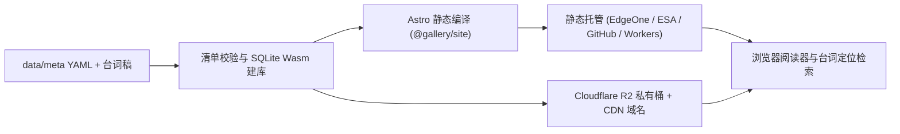

<p align="center">
  
</p>

<h1 align="center">页间 · Pagehaven</h1>

<p align="center">在页间，遇见好故事。</p>

<p align="center">
  <a href="README.md"></a>
  <a href="README.en.md"></a>
</p>

<p align="center">
  <a href="https://pagehaven.cbnv.me/">在线文档站</a> · <a href="#快速开始">快速开始</a> · <a href="#选型与边界-faq">选型与边界 FAQ</a> · <a href="#阅读路径导航">阅读路径</a> · <a href="#许可与致谢">许可协议</a>
</p>

页间（Pagehaven）是一套面向连载与归档的**纯静态漫画库、多模式阅读器与浏览器端台词检索引擎**（AGPL-3.0）；它以静态 HTML 产物、外部私有对象存储与边缘 CDN 协同运行，**明确不提供用户系统、评论区、服务端渲染或在线后台上传**。

## 核心能力与数据流

- **每话单 HTML 渐进阅读**：基于 Astro 7.4 编译，每话仅生成一个纯静态页面（适配 2k–20k 托管预算），无 JavaScript 时完整保留图片与台词文本，启用脚本后支持单页/条漫/双页、RTL/LTR、`#p<n>b<i>` 台词高亮定位及可选 `@yui540/comimi` 分页。
- **浏览器端 SQLite Wasm 台词检索**：构建期按与查询完全一致的 `normalizeText` 管线（NFKC → 去标点 → OpenCC 繁转简 → 小写）生成 `FTS5 trigram` 数据库；≥3 字走 `MATCH`，2 字退化 `LIKE`，整库在 `30 MiB` 预算内经 SHA-256 校验后本地查询。
- **本地书架与可迁移备份**：作品收藏、阅读历史与页码备注（最多 200 字）纯浏览器存储，支持 5 MiB / 20,000 条记录上限的 `pagehaven-reading-backup` JSON 校验导入导出。
- **多端便携与不可变发布**：同一份 `dist/` 兼容 EdgeOne、ESA、GitHub Pages、Workers 与 legacy Cloudflare Pages；图片（WebP）与检索库经 R2 私有桶 + CDN 域名分离读取，生产指针在全目标随机证明核对后条件切换。

## 能力定位与明确不能做什么

| 维度 | 能做到什么程度（已实现能力） | 明确不能做什么（非目标与硬限制） |
| --- | --- | --- |
| 归档与阅读 | Astro 每话单 HTML 渐进增强阅读，无 JS 可读图文，支持单页/条漫/双页、`#p<n>b<i>` 跳转与可选 Comimi 分页 | **不做**账号登录、评论系统、SSR 服务器或在线传图管理后台 |
| 台词检索与分块 | `normalizeText` + SQLite Wasm（≥3 字 `MATCH` / 2 字 `LIKE`）；`@gallery/core/chunkfetch` 已实现 HTTP Range 取块原语 | 归一化 `<2` 字拒绝查询；整库下载限 `30 MiB`；`chunkfetch` **尚未接入**浏览器端 SQLite VFS；未校对 OCR 不自动进索引 |
| 书架与备份迁移 | `localStorage` 持久化进度/书签/200 字笔记；`pagehaven-reading-backup` JSON 白名单校验迁入迁出 | 单份备份硬限 `5 MiB` / `20,000` 条记录；**不做**云端跨设备账号同步 |
| 托管预算与发布 | 四端同源构建；R2 上传 + 随机 HTTPS 证明核对 + `If-Match` 条件激活线上 `manifest.json` | ESA 硬上限 `2,000` 文件（业务 ≤ `1,999`）；`github`/`all` 拒收预览部署；`site.config.yaml` 禁止写凭据与示例域 |



## 快速开始

需准备 **Node.js `>=22.19.0`** 与 **pnpm `>=10.0.0`**（默认仓库以空白通用模板起步）：

```sh
pnpm install --frozen-lockfile
pnpm run build
pnpm run check
pnpm --filter @gallery/site run preview
```

构建后默认在 `http://localhost:4321` 启动静态预览（使用仓库内置最小夹具可设 `DATA_DIR=packages/core/test/fixtures/data`）。其他高频工作流与文档入口如下：

| 目标场景 | 核心命令 / 配置 | 详细文档 |
| --- | --- | --- |
| 初始化与可视化改色 | `pnpm run init` / `pnpm run customize`（`127.0.0.1:4318`） | [起步与上手](docs-site/docs/index.md) |
| 导入 LabelPlus / OCR 台词稿 | `pnpm run ingest:labelplus` / `pnpm run ingest:ocr` | [配置与数据契约](docs-site/docs/configuration.md) |
| 四端静态部署与 R2 不可变发布 | `publish:r2` → `release:prepare` → `deploy:*` → `release:activate` | [多模式与多平台部署](docs-site/docs/deployment.md) |
| 启动/构建独立 VitePress 文档站 | `pnpm --dir docs-site install --frozen-lockfile && pnpm --dir docs-site run docs:dev` | [源码地图与文档工作流](docs-site/docs/code-map.md) |
| 交互式查阅 Schema / SDK / 发布 CLI | 查看 `site.config.yaml`、`@gallery/*` 契约与标准调用示例 | [API 与组件参考](docs-site/api-reference/index.md) |

## 选型与边界 FAQ

**没有后端服务器或边缘函数能完整使用吗？**
可以。`features.platform_config: false` 时仍可运行全套浏览、阅读设置、书架/备份和浏览器端 SQLite Wasm 检索；`search.api_path` 仅预留接口槽位，非运行前提。

**为什么 R2 必须私有，必须额外经过 CDN 域名？**
R2 写入凭据仅存于 CI 密钥中用于发布，所有公开 WebP 图片与检索库只通过 `images.hosts` CDN 域名（S3v4 私有回源）读取，避免暴露桶凭证并兼顾多 CDN 切换。

**为什么每话不每页拆成一个 HTML 文件？**
为了能在免费静态托管预算内承载大规模作品（Workers guard 上限 `18,000` 文件、ESA 硬上限 `2,000` 文件含验证预留），每话只产出一份静态 HTML，页内完成翻页与按需目录分片加载（`/index/<series>.json`）。

**站点超过单平台上限或台词检索库过大怎么办？**
`pnpm run check` 与发布前预算检查会在上传前阻断超限产物（ESA ≤ 1,999 业务文件 / 1,024,000,000 B；`db.whole_download_max_bytes` 默认 30 MiB），多源 HTTP Range 探测基建已内置于 `@gallery/core/chunkfetch`，尚未接入检索 VFS。

**OCR 草稿会自动进入正式检索库吗？**
不会。`ingest:ocr` 默认只生成人工校对草稿与对照 HTML，必须经人工校对后使用 `--accept-reviewed` 显式导入 `data/text/` 才参与建库与站点构建。

**支持哪些本地验证与安全防线？**
仓库内置 `pnpm run check`（校验配置、Budget、Web 标准边界、禁 `sharp`、README 锚点及流水线策略）与 `tools/githooks/`（拦截明文凭据与规范提交格式）；详细贡献分级见 [CONTRIBUTING.md](CONTRIBUTING.md)。

## 阅读路径导航

| 读者目标 | 文档站入口（面向使用与接入） | 仓库工程指南（面向源码与运维） |
| --- | --- | --- |
| 环境安装、部署矩阵与故障排查 | [起步](docs-site/docs/index.md) · [部署](docs-site/docs/deployment.md) · [FAQ](docs-site/docs/faq.md) | [文档与验证入口](repo-docs/README.md) · [发布流水线模块](repo-docs/modules/release-pipeline-and-proofs.md) |
| 配置 schema、数据格式与扩展边界 | [边界](docs-site/docs/boundaries.md) · [配置](docs-site/docs/configuration.md) · [交互](docs-site/docs/interactions.md) | [配置与目标](repo-docs/modules/site-config-and-targets.md) · [数据模型与归一化](repo-docs/modules/data-model-and-normalization.md) |
| 主流程演练、检索内核与阅读器机制 | [演练](docs-site/docs/walkthrough.md) · [架构](docs-site/docs/architecture.md) · [源码地图](docs-site/docs/code-map.md) | [一次真实主流程](repo-docs/walkthroughs/one-real-run.md) · [代码地图](repo-docs/code-map.md) · [架构归档](docs/ARCHITECTURE.md) |
| 检索实现、阅读器交互与领域术语 | [检索与阅读架构](docs-site/docs/architecture.md) | [检索与分块](repo-docs/modules/search-db-and-chunkfetch.md) · [阅读器与书架](repo-docs/modules/static-reader-and-bookmarks.md) · [术语表](repo-docs/glossary.md) |
| 历史架构决策、版本演进与贡献规范 | [版本变更与迁移](docs-site/docs/changelog.md) · [DESIGN.md](DESIGN.md) | [指南变更记录](repo-docs/change-log.md) · [CONTRIBUTING.md](CONTRIBUTING.md) · [SECURITY.md](SECURITY.md) |

## 许可与致谢

本项目采用 [AGPL-3.0-only](LICENSE) 开源许可发布；构建配置已显式剔除 `astro>sharp`（LGPL libvips），零额外原生图像依赖，字体及许可声明随 `packages/site/public/licenses/` 一并分发。

核心技术依赖及致谢：[Astro](https://astro.build/)、[SQLite Wasm](https://sqlite.org/wasm)、[opencc-js](https://github.com/nk2028/opencc-js)、[@yui540/comimi](https://github.com/yui540/comimi)、[Anime.js](https://animejs.com/) 与 [VitePress](https://vitepress.dev/)。
