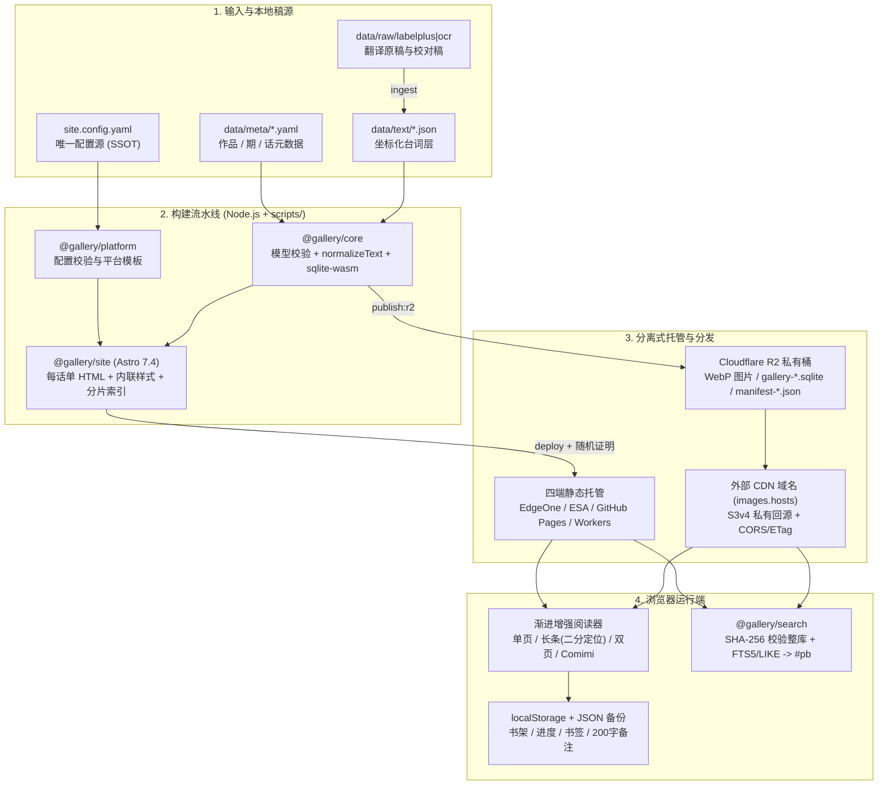

# 核心子系统与架构全景

Pagehaven 的架构围绕一个目标设计：**用最低长期维护成本和零服务端依赖，把漫画归档、多模式阅读和全文台词检索稳定运行在免费静态边缘网络上。**

## 整体架构拓扑

## 交互式管线全景图

下方图表基于仓库内置的真实漫画管线交互视图，展示从 **01 原始稿件** 到 **02 规范化 IR**、**03 发布产物** 与 **04 阅读引擎** 的四段流转（支持拖拽平移与缩放）：

<DiagramFrame
  src="/diagrams/pagehaven-pipeline.html"
  title="Pagehaven 漫画管线交互全景图"
  aspect="720 / 652"
  new-tab-label="在新窗口全屏打开 ↗"
/>

> **历史概念图说明**：仓库中另保留了一份早期概念交互草图 [`/diagrams/pagehaven-architecture.html`](/diagrams/pagehaven-architecture.html) 用于兼容既有静态路径测试，其旧标签（如 Vue / IndexedDB / EPUB）已被本页所述的 **Astro + SQLite Wasm + R2 + 四端静态托管** 架构替代，具体实现请以本页与 `docs/ARCHITECTURE.md` 为准。

## 四个核心工作区包

| 工作区包 | 运行边界 | 职责与核心实现 |
| --- | --- | --- |
| `@gallery/core` | 纯 Web 标准（无 `node:*`） | 数据模型与 Zod schema、safe object-path、LabelPlus 解析、5 步幂等 `normalizeText`、SQLite Wasm `buildGalleryDb` / `computeChunkManifest`、以及独立多源 Range 取块层 `chunkfetch` |
| `@gallery/platform` | 构建期 Node 工具 | `site.config.yaml` Zod 校验、`DEPLOY_TARGETS` / `TARGET_CAPABILITIES` 注册、`GENERATED_FILES` 与 `DEPLOY_CONFIG_FILES`（`wrangler.jsonc`/`esa.jsonc`）生成器 |
| `@gallery/search` | 纯 Web 标准（浏览器 + 单测） | `loadGalleryDb`（固定构建版本 + 流式长度上限 + SHA-256）、`prepareQuery` / `queryLines`（`MATCH` / `LIKE` / `#p<n>b<i>` 跳转结果）、`mountSearch`（覆盖率与最短长度懒加载门控） |
| `@gallery/site` | Astro 7.4 静态生成 + 原生 JS | 首页、作品、刊期、每话阅读器、`/search/`、`/library/`、`404.html`、三态明暗系统、100 条目分片目录、二分法条漫定位、可选 Comimi 分页与 5 MiB 阅读备份迁移 |

## 检索内核：五步幂等归一化与混合查询

为保证繁体/简体、全角/半角、标点夹杂和部首替换字都能在构建期索引与浏览器查询间精确命中，`packages/core/src/normalize.js` 严格锁定以下顺序：

1. **首轮 NFKC**：先把全角字母、半角片假名、兼容汉字和康熙部首（例如 `⾞ U+2F9E → 車`）折回标准码位，否则后续 OpenCC 词典不识别部首码位；
2. **清除标点、空白、符号、控制字符与变体选择符**：刻意排除 `\p{C}` 中的 `Cn`（未分配码位），以免 Node 构建端与旧手机浏览器 Unicode 表版本差异导致一端删除、一端保留；
3. **次轮 NFKC**：相邻残余组合符号重新合并（如分离重音符号与基字）；
4. **OpenCC `t → cn`**：使用仅约 110 KB 的纯 JS `opencc-js/t2cn` 单向繁转简词典（避免 1.2 MB 双向词典，不发网络请求）；
5. **转小写**：统一折叠拉丁字母大小写。

查询调度策略（`packages/search/src/query.js`）：
- **归一化后 `< 2` 字**：直接拒绝并跳过数据库下载，避免全表扫描与数千条噪音结果；
- **归一化后 `=== 2` 字**：跳过 FTS5 trigram（trigram 最小单位为 3 字符），自动使用带 `ESCAPE '\'` 转义的 `l.text_norm LIKE ?` 扫描，并优先利用 `series_id` 过滤；
- **归一化后 `>= 3` 字**：自动对输入双引号转义并拼为短语查询 `lines_fts MATCH ?`，按书架顺序（作品 → 期 → 话 → 页 → 框）每批返回最多 50 条及 `hasMore` 游标。

## 阅读器内核：大规模目录与高性能交互

- **无脚本与渐进增强**：章节 HTML 默认以标准文档流输出所有页图片与文字层 DOM；页尾内联脚本同步将视图切换为阅读器模式，消除首屏闪烁。
- **按需目录分页（`/index/<series>.json`）**：每话静态 HTML 侧栏仅内联常量规模邻近目录；首次打开完整目录时按需请求作品索引 JSON 并按每组 **100 话** 分片渲染，支持筛选、组号跳转与跨标签页进度缓存。
- **对数级条漫页码追踪**：长条模式按页顶纵向位置执行**二分查找**实时定位当前阅读页，把 1,000 页章节的单帧位置读取从 900 次降至最多 10 次，同时规避图片懒加载高度变化导致的缓存失真。
- **`chunkfetch` 多源 Range 基建**：`packages/core/src/chunkfetch/` 已完整实现按块 `HEAD`/`GET Range` 探测、`SourceSet` EMA 延迟优选、跨源指数退避重试与逐块 SHA-256 校验（所有源无视 Range 时回抛 `needs-whole`）。当前线上检索默认先走有上限整库下载，待后续接入 SQLite VFS 后可平滑开启按块拉取。
