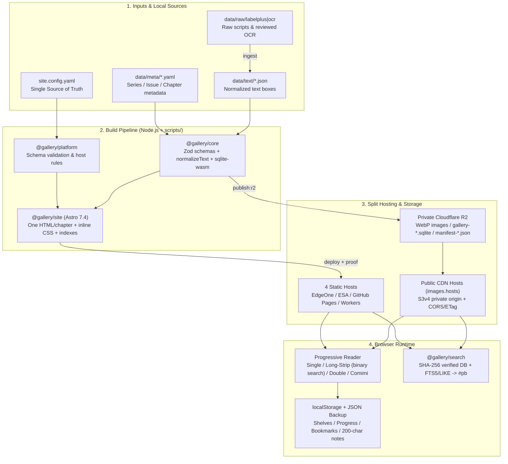

# Subsystems & Architecture Overview

Pagehaven's architecture is designed around one durability goal: **keep comic archives, progressive reading, and full-text dialogue search operational on free static edge tiers with zero backend servers.**

## System Architecture Topology

## Interactive Pipeline Diagram

The interactive diagram below traces Pagehaven's four-stage data pipeline (**01 Raw Ingest** → **02 Normalized IR** → **03 Bundle** → **04 Reader Engine**, pan and zoom enabled):

<DiagramFrame
  src="/diagrams/pagehaven-pipeline.html"
  title="Pagehaven Comic Pipeline Interactive Diagram"
  aspect="720 / 652"
  new-tab-label="Open fullscreen ↗"
/>

> **Legacy Conceptual Diagram Note**: An earlier draft diagram remains preserved at [`/diagrams/pagehaven-architecture.html`](/diagrams/pagehaven-architecture.html) for legacy asset path continuity; its outdated labels (Vue / IndexedDB / EPUB) have been superseded by the **Astro + SQLite Wasm + R2 + Static Hosts** architecture documented here and in `docs/ARCHITECTURE.md`.

## Four Workspace Packages

| Package | Runtime Boundary | Responsibilities |
| --- | --- | --- |
| `@gallery/core` | Pure Web-standard (no `node:*`) | Zod data models, `object-path`, LabelPlus parser, 5-step idempotent `normalizeText`, `buildGalleryDb` / `computeChunkManifest`, and standalone `chunkfetch` Range prober |
| `@gallery/platform` | Build-time Node tooling | `site.config.yaml` schema, `DEPLOY_TARGETS` / `TARGET_CAPABILITIES`, `GENERATED_FILES` & `DEPLOY_CONFIG_FILES` (`wrangler.jsonc`, `esa.jsonc`) |
| `@gallery/search` | Pure Web-standard (browser & tests) | `loadGalleryDb` (pinned build release + streaming cap + SHA-256), `prepareQuery` / `queryLines` (`MATCH` / `LIKE` / `#p<n>b<i>`), and `mountSearch` |
| `@gallery/site` | Astro 7.4 + Vanilla JS | Home, series, issue, chapter reader, `/search/`, `/library/`, `404.html`, color-scheme sync, 100-item TOC pagination, binary-search scroll, optional Comimi, and 5 MiB backup |

## Search Engine Internals: Normalization & Hybrid Queries

`packages/core/src/normalize.js` enforces an idempotent 5-step sequence on both indexed lines and user queries:

1. **First NFKC**: Folds fullwidth ASCII, halfwidth katakana, and Kangxi radicals (e.g., `U+2F9E`) to standard characters so OpenCC recognizes them;
2. **Strip Punctuation, Whitespace, Symbols, Control Chars & Variation Selectors**: Excludes `\p{C}`'s `Cn` (unassigned code points) so Node build environments and older mobile browsers stay deterministic across Unicode versions;
3. **Second NFKC**: Re-composes newly adjacent combining marks after separators are removed;
4. **OpenCC `t → cn`**: Uses the compact ~110 KB `opencc-js/t2cn` dictionary offline with zero runtime fetches;
5. **Lowercase**: Normalizes Latin letters uniformly.

Query dispatch in `packages/search/src/query.js`:
- **`< 2` normalized chars**: Rejected immediately on the client without downloading the DB;
- **`=== 2` chars**: Bypasses FTS5 trigram (minimum 3 chars) and executes escaped `l.text_norm LIKE ? ESCAPE '\'` joined with `series_id`;
- **`>= 3` chars**: Escapes double quotes into an FTS5 phrase `lines_fts MATCH ?`, returning 50 results per page ordered by bookshelf order (`series -> issue -> chapter -> page -> box`).

## Reader & Chunkfetch Internals

- **Progressive Static Output**: All chapter images and text boxes render in plain HTML; an inline footer script switches directly into single/long/double-page mode without flash of unstyled content.
- **On-Demand 100-Item TOC (`/index/<series>.json`)**: Chapter HTML embeds only constant-size neighbor links; opening the full TOC lazily fetches the series JSON and paginates at 100 entries per group.
- **Logarithmic Long-Strip Tracking**: Binary-searches live page offsets rather than linearly scanning all elements per scroll frame, dropping 1,000-page read cost from 900 checks to at most 10.
- **Standalone `chunkfetch` Range Prober**: `packages/core/src/chunkfetch/` supports multi-source probing, `SourceSet` EMA latency ranking, chunk SHA-256 verification, and `needs-whole` fallback signaling, ready for future SQLite VFS integration.
